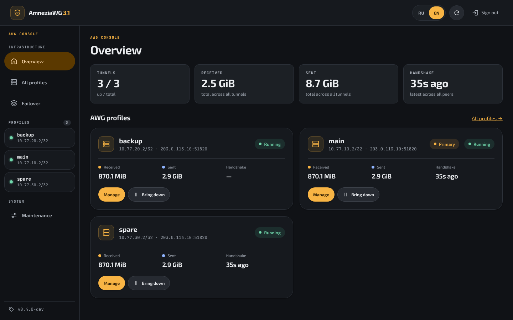
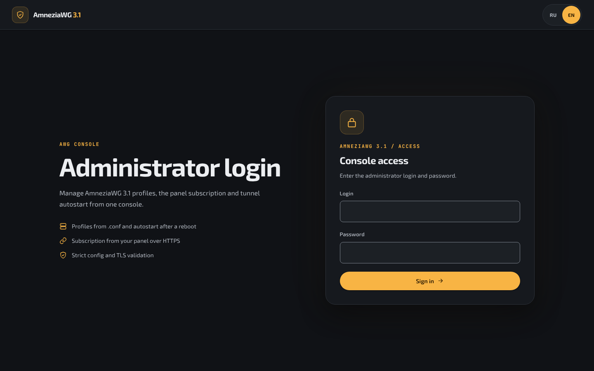
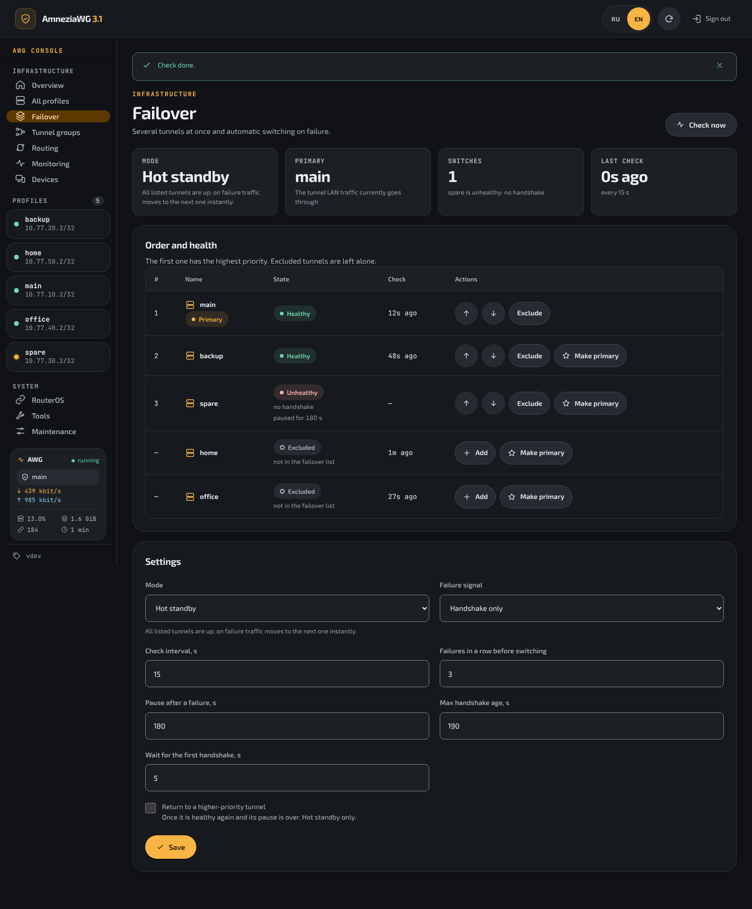
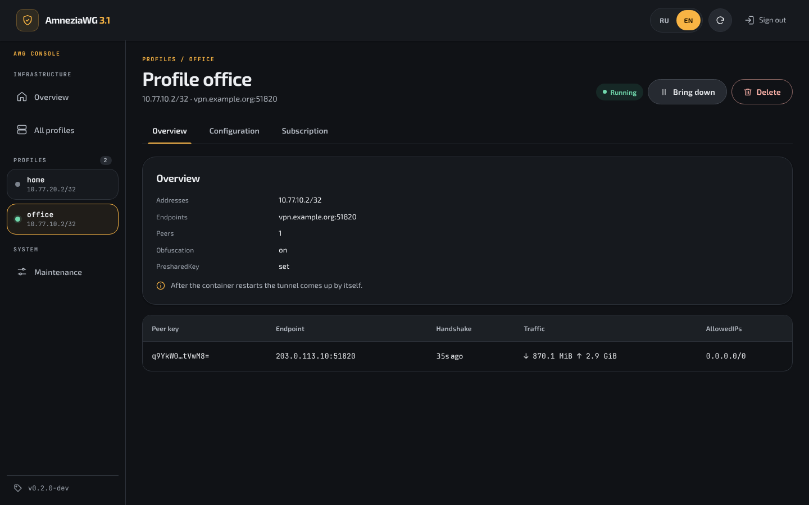
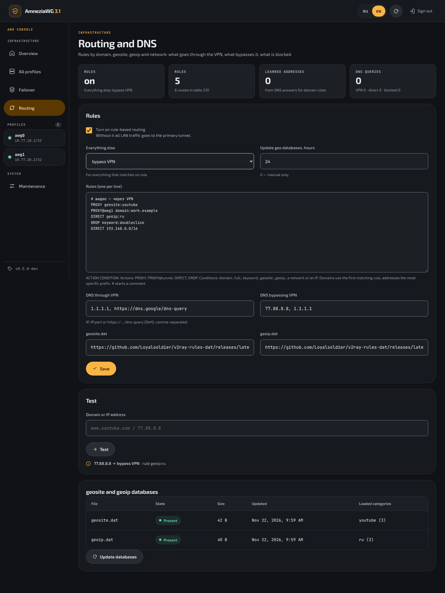
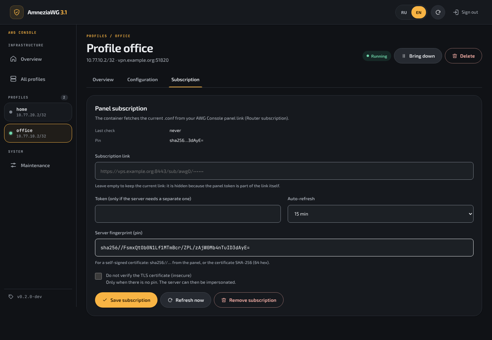
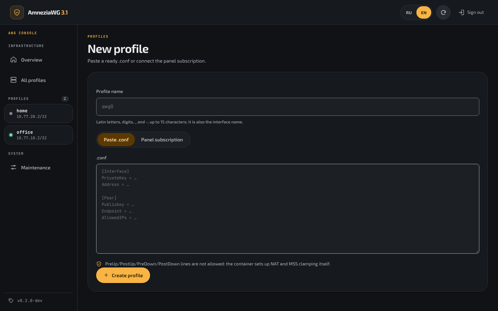
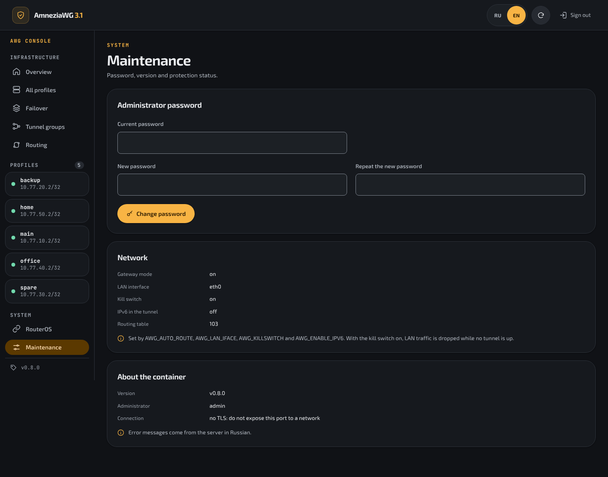
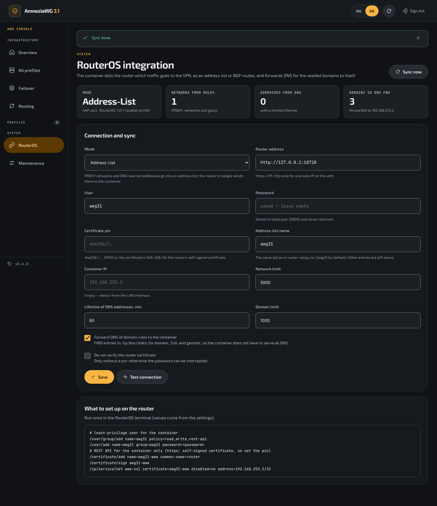
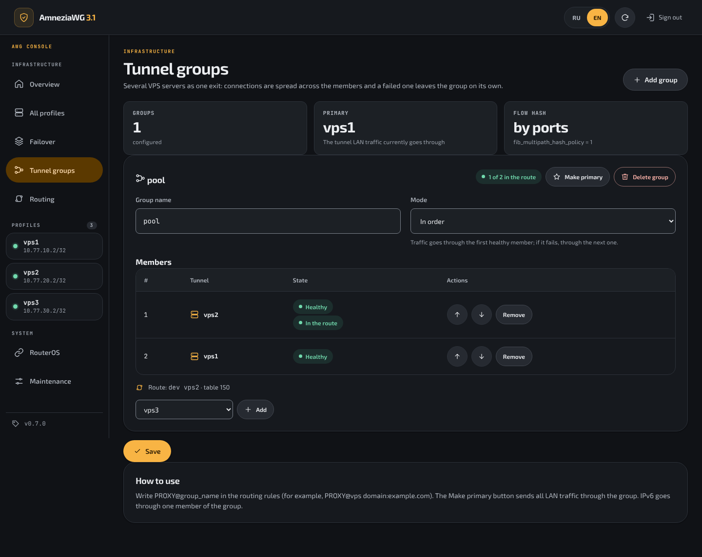

# AmneziaWG 3.1 Console for Docker

**English** · [Русский](README.ru.md)

An **AmneziaWG 3.1** client in a container with a bilingual (RU/EN) web console that looks and behaves like the [amneziawg31-installer](https://github.com/stepm65/amneziawg31-installer) panel: `.conf` profiles, turning tunnels on and off, autostart after a reboot and **a subscription taken straight from your panel**. Runs in Docker and **on MikroTik routers (arm64 and arm32)**. No CDN, no third-party Go modules, no web terminal.

Version **0.8.2** · GPL-3.0 licence · not affiliated with the AmneziaVPN developers.



## Features

- **AmneziaWG 3.1 only.** The image builds `amneziawg-go` and `amneziawg-tools` from upstream; both the tag and the commit hash are pinned, so a moved tag cannot swap the code.
- **Panel subscription.** The container fetches the current `.conf` from `https://host/sub/<interface>/<token>`, the link of the panel's "Router subscription" section: conditional requests with `ETag` (`304` answers), `sha256//…` key pinning for a self-signed certificate, clear handling of `403`, `404` and `429`. Details below.
- **Rollback on failure.** If the new configuration does not come up, the previous file and the previous tunnel are restored; the `ETag` is not advanced, so the next check tries again.
- **Stale tunnel bypass.** If there has been no handshake for more than 3 minutes and the link is unreachable, the tunnel is taken down for a moment and the configuration is requested directly, as the panel's `awg-sub.sh` does.
- **Strict `.conf` validation** against the upstream 3.1 key list: `Jc`, `Jmin`, `Jmax`, `S1`–`S4`, `H1`–`H4`, `I1`–`I5`, `HeaderProtectionKey`, `ContentPaddingAddition`, `RandomTrailers`, `DisableCookies`, `RekeyAfterTime`, `RekeyTimeout`, `RejectAfterTime`, `KeepaliveTimeout`, `MaxHandshakeAttempts` and the peer's `AdvancedSecurity`. Ranges `a-b`, 32-byte base64 keys, ports and CIDRs are checked by type.
- **Several profiles** at once: up and down, handshake and traffic per peer, tunnels that were up come back after a container restart.
- **Gateway mode:** LAN traffic enters the tunnel through a separate routing table while the container's own traffic (subscription, handshakes) goes directly; NAT (`MASQUERADE`) and MSS clamping are generated by the application itself (`AWG_AUTO_ROUTE=on`).
- **Several tunnels and failover:** tunnels run at the same time, each with its own routing table; the primary one (where LAN traffic goes) changes with a single command, without restarts. Modes "hot standby" (all up, instant switch) and "switch over" (only the primary is up); failure is detected by handshake, a TCP probe through that particular tunnel, or both; failure threshold, pause after a failure, return to a higher-priority tunnel. A Failover page shows the order and health of tunnels.
- **Tunnel groups and balancing:** several VPS servers as one exit. "Balancing" spreads new connections across the healthy members by weight (one flow stays in one tunnel); "In order" sends traffic through the first healthy member. A failed member leaves the route on its own and comes back after its pause. A group can be made the primary exit or used in rules: `PROXY@group` ("these sites go through VPS-1, and if it is down, through VPS-2"). A Tunnel groups page.
- **Rule-based routing and DNS:** `PROXY` / `PROXY@tunnel` / `PROXY@group` / `DIRECT` / `DROP` rules by domain, `geosite:`, `geoip:` and network; v2ray `geosite.dat`/`geoip.dat` databases (or plain text lists) are downloaded on a schedule and only the needed categories are loaded into memory. A DNS forwarder (UDP/TCP, DoH) sends queries for `PROXY` through the tunnel and for `DIRECT` around it, and answers NXDOMAIN for `DROP`; addresses from answers are remembered so traffic to them takes the same path. The Routing page is a table of services with an icon, conditions, a destination, an on/off switch and drag-and-drop ordering; the service catalog and its icons work offline, and the rules themselves stay plain text you can edit by hand. The database source switches with one button, including [IPList](https://iplist.opencck.org/) (its tags are named after sites and groups, e.g. `geoip:telegram.org`, and the container fetches site icons from it). Once the databases are downloaded, the "Add service" dialog lists every category they contain, with search. There is also a "where will this domain or IP go" check.
- **RouterOS integration:** the container maintains an address list on the router itself (`PROXY` networks permanently, DNS-learned addresses with a timeout) or announces them over **BGP**, and adds FWD entries to `/ip/dns/static` for domain rules. It uses the RouterOS 7 REST API as a separate least-privilege user; the router certificate is pinned and other entries are left alone. The "RouterOS" page tests the connection and shows ready-made router commands.
- **Server mode:** a profile with `ListenPort` and peers without `Endpoint` comes up as an AmneziaWG server, and its clients reach the internet through the container's LAN; on MikroTik the `awg31_server_*` rules forward port 51821/udp.
- **Kill switch and IPv6:** while no tunnel is up, LAN traffic is dropped instead of bypassing the VPN (`AWG_KILLSWITCH=on`); IPv6 in the tunnel with NAT66 and, on MikroTik, a ULA address on the veth if the router gives none (`AWG_ENABLE_IPV6=on`).
- **Panel look and feel:** dark theme with an amber accent, Exo 2 and JetBrains Mono served from the image, sidebar, cards, a **RU / EN** switch (remembered in the browser) and a layout that works down to a phone.
- **MikroTik RouterOS:** `linux/arm64` and `linux/arm/v7` images, an `/app` manifest, install and address-list routing scripts, offline `.tar` archives in every release. Details: [docs/MIKROTIK.md](docs/MIKROTIK.md) (Russian).
- **Health probe** for RouterOS `/tool/netwatch` or any monitor: status code only, empty body.
- **Safe defaults:** one-time setup token, HTTPS by default, strict CSP without inline code, CSRF checks, secrets never returned by the API. Every problem found in the prototype is tied to a test: [docs/SECURITY.md](docs/SECURITY.md) (Russian).

## Requirements

| | |
|---|---|
| Docker | Docker Engine with Compose v2 on Linux; `/dev/net/tun` and the `NET_ADMIN` capability |
| Architecture | amd64, arm64, arm/v7 (multi-arch image from CI) |
| MikroTik | RouterOS 7.20+ (7.22+ for `/app`), `container` package, arm64 or arm (ARMv7), external disk |
| Network | outbound HTTPS to the panel; UDP access to your AmneziaWG server |

## Quick start

```bash
docker compose up -d --build
docker logs awg31          # the one-time setup token is here
```

Open <https://127.0.0.1:8443> (the certificate is self-signed; its SHA-256 fingerprint is printed in the log), enter the token from the log and choose a login and a password (at least 10 characters). Then add a profile and press "Bring up".

By default the console is reachable only from the host's localhost. To open it to the LAN, change `ports` in `docker-compose.yml`. **Do not publish the port to the internet.** Behind a reverse proxy, set `TRUSTED_PROXIES`.

The administrator can also be set without a token through a secret: `ADMIN_PASSWORD_FILE=/run/secrets/awg31_admin_password` (see the comments in `docker-compose.yml`).

## MikroTik

On RouterOS 7.22+ one command is enough:

```
/app/add yaml-url="https://raw.githubusercontent.com/stepm65/awg31-docker/main/routeros/app.yaml"
```

For RouterOS 7.20–7.21 and offline installs: `routeros/install-container.rsc` (with the `.tar` for your architecture from the release), with `routeros/router-setup.rsc` uploaded next to it (the install script applies it itself). Supported models, address-list routing and what was verified: [docs/MIKROTIK.md](docs/MIKROTIK.md) (Russian).

## Subscription from the panel

This is how the container gets the configuration of a client you created in [AWG Console](https://github.com/stepm65/amneziawg31-installer):

1. In the panel, open the client → "Router subscription" → **"Enable subscription"**. The panel shows, once, a link like `https://your-host/sub/awg0/…` and the `awg-sub.sh` script.
2. In the container console: **New profile → Panel subscription**, paste the link. The token is inside the link, so the separate "Token" field is not needed (it remains for servers that expect `Authorization: Bearer`).
3. For a self-signed panel certificate, paste the key pin from `awg-sub.sh` (the value after `--pinnedpubkey`, like `sha256//…`) or the SHA-256 of the certificate itself (64 hex characters). Without a pin the certificate chain is verified; "Do not verify TLS" is a separate, explicit option and is not recommended.
4. Choose an interval (5 minutes or more) and save. "Refresh now" checks immediately.

Good to know:

- **The link is a secret.** The panel token sits in the address, and the link returns the client's private key. The container API therefore **never returns the whole link**: the UI shows `https://…/sub/awg0/••••••` (the last path segment is always hidden and credentials in the address are not shown). Leaving the field empty on save keeps the stored link. Error messages hide it too.
- **Panel answers.** `304` — nothing changed; `403` — the client is switched off in the panel; `404` — the link is invalid (a new one was issued); `429` — too many requests, wait. Anything else is a network error. Messages appear on the profile page.
- **Hooks from a subscription are dropped.** The panel may add `PreUp`/`PostUp`/`PreDown`/`PostDown` and `Table` lines to `[Interface]` (gateway templates for routers). `awg-quick` runs them through `eval`, so the container **does not run them**: it removes them from the downloaded configuration and keeps `Table` only as `auto` or `off`. A notice above the profile says what was removed. The container sets up NAT and MSS itself. A `.conf` pasted by hand with hooks is still rejected as a whole.
- **An update never breaks a working setup.** The configuration is cleaned and validated first, then written; the tunnel restarts only if it was up and the content changed. If the new configuration does not come up, the previous one is restored (see "Rollback on failure").

## Environment variables

| Variable | Purpose | Default |
|---|---|---|
| `DATA_DIR` | Data directory (profiles, `state.json`, TLS) | `/data` |
| `UI_LISTEN` | Console address inside the container | `:8443` |
| `UI_TLS` | `auto` (self-signed), `files` (your own), `off` | `auto` |
| `UI_TLS_CERT`, `UI_TLS_KEY` | Certificate and key paths when `UI_TLS=files` | — |
| `UI_TLS_SANS` | Extra names/IPs in the self-signed certificate | — |
| `AWG_AUTO_ROUTE` | Gateway mode: NAT, MSS clamping and routing LAN traffic through a separate table | `on` |
| `AWG_KILLSWITCH` | Kill switch: while no tunnel is up, LAN traffic is dropped (blackhole) instead of bypassing the VPN | `on` |
| `AWG_ENABLE_IPV6` | IPv6 in the tunnel: NAT66, IPv6 rules and routes; without IPv6 in the container only IPv4 is used | `on` |
| `AWG_LAN_IFACE` | Interface LAN traffic arrives on | interface of the default route |
| `DNS_ENABLE` | DNS forwarder for domain rules (in gateway mode) | `on` |
| `DNS_LISTEN` | Forwarder address | `:53` |
| `DNS_ALLOW` | Who may query (comma-separated CIDRs); by default private networks and loopback, so the forwarder never becomes an open resolver | private networks |
| `AWG_FAILOVER_MODE`, `AWG_FAILOVER_TRIGGER`, `AWG_FAILOVER_PROBE`, `AWG_FAILOVER_FAILBACK` | Initial failover settings (`off`/`standby`/`switch`, `hybrid`/`handshake`/`probe`, `IP:port`, `on`/`off`); applied once, then changed on the Failover page | `off`, `hybrid`, `1.1.1.1:443`, `off` |
| `AWG_BIN`, `AWG_QUICK_BIN` | Paths to `awg` and `awg-quick` (custom builds and tests) | `/usr/bin/awg`, `/usr/bin/awg-quick` |
| `ADMIN_USER`, `ADMIN_PASSWORD_FILE` / `ADMIN_PASSWORD` | Set the administrator on first start without a token (prefer the secret file) | — |
| `ALLOW_INSECURE_SUBSCRIPTIONS` | Allow `http://` subscriptions (**not recommended**: the key travels in clear text) | `off` |
| `TRUSTED_PROXIES` | Proxies (IP/CIDR) whose `X-Forwarded-For` is trusted | — |
| `HEALTH_LISTEN` | Health probe address, e.g. `:8081` | off |
| `HEALTH_MAX_HANDSHAKE_SEC` | Maximum handshake age for the probe (`0` — do not check) | `0` |
| `RUN_DIR` | Directory for working config copies (tmpfs in compose) | `/run/awg31` |

## Console

| Sign in | Overview |
|---|---|
|  |  |

| Failover | Profile |
|---|---|
|  |  |

| Routing and DNS | Panel subscription |
|---|---|
|  |  |

| New profile | Maintenance |
|---|---|
|  |  |

| RouterOS integration | Tunnel groups |
|---|---|
|  |  |

The screenshots show demonstration data on a test stand without a real tunnel. Russian versions are next to them (`docs/screenshots/ru-*.png`). Server error messages are in Russian for now; the interface itself is fully translated.

## Security

In short: a one-time setup token; HTTPS and `__Host-` cookies by default; `awg-quick` hooks are never executed; the subscription link and keys are never returned by the API; SSRF protection for subscriptions; `cap_drop: ALL` + `NET_ADMIN`; no web terminal. The full "problem → fix → test" table, residual risks and what was not exercised are in [docs/SECURITY.md](docs/SECURITY.md) (Russian). To report a vulnerability see [SECURITY.md](SECURITY.md).

## Not implemented yet

Deliberately postponed to keep the core small and verifiable. The panel has these, this container does not:

- Telegram bot and notifications, two-factor sign-in, backups, VPS fleet management;
- QR codes and the `vpn://` format, logs, traffic charts.

## Development

```bash
go vet ./... && go test -race ./...
node --check internal/web/static/app.js
```

There are no external Go dependencies, only the standard library. The UI is embedded into the binary (`//go:embed`) together with the fonts. The version lives in the `VERSION` file: the Dockerfile reads it at build time, CI compares it with the tag, and a test keeps it from drifting from the READMEs. Layout: [docs/ARCHITECTURE.md](docs/ARCHITECTURE.md) (Russian).

## Licences

GPL-3.0, see [LICENSE](LICENSE). The fonts and the upstream components of the image (`amneziawg-go`, `amneziawg-tools`) keep their own licences: [THIRD_PARTY.md](THIRD_PARTY.md).
