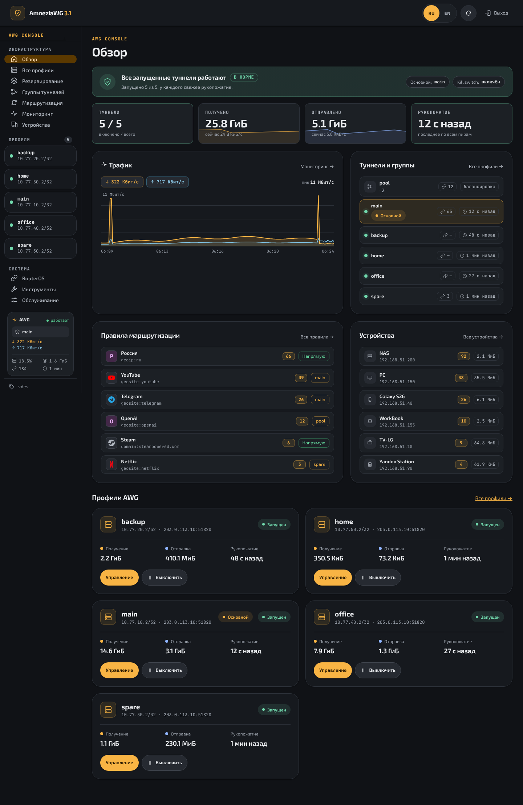
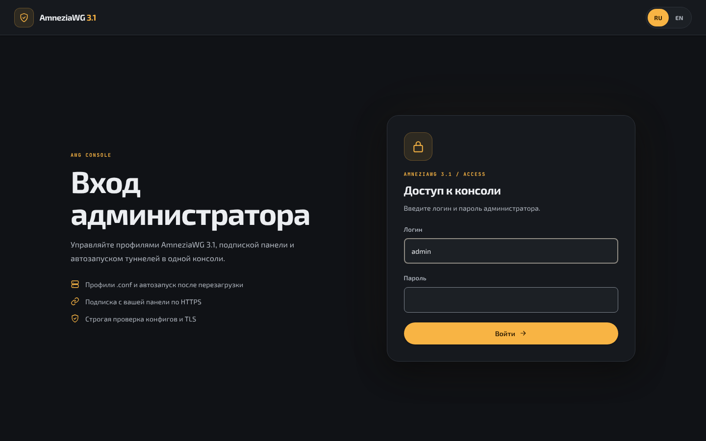
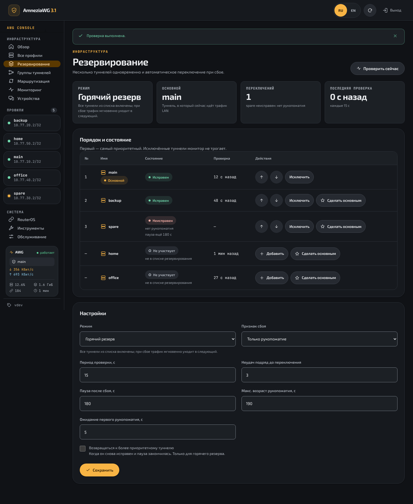
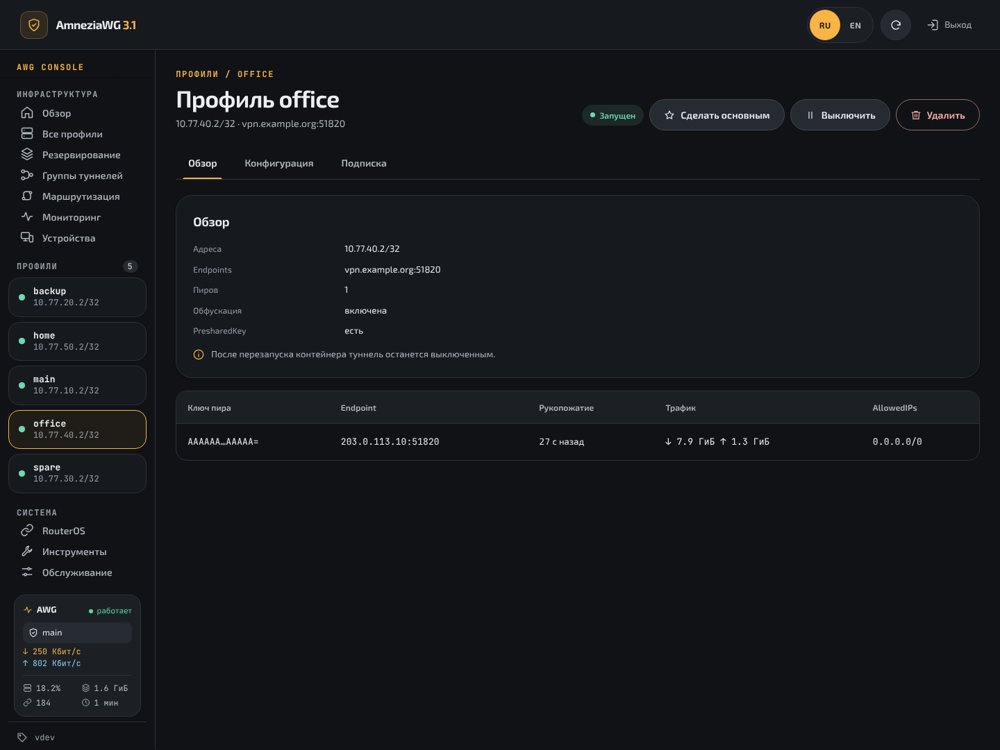
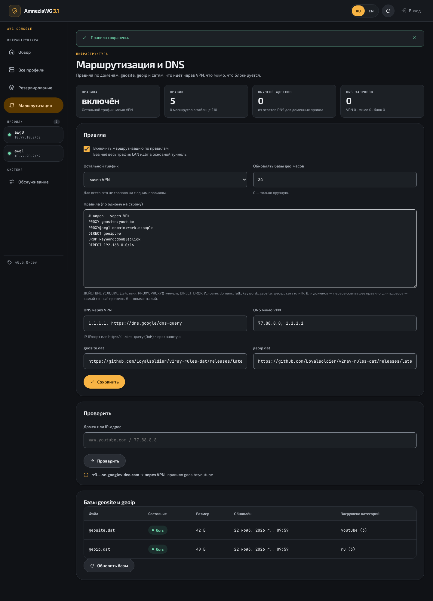
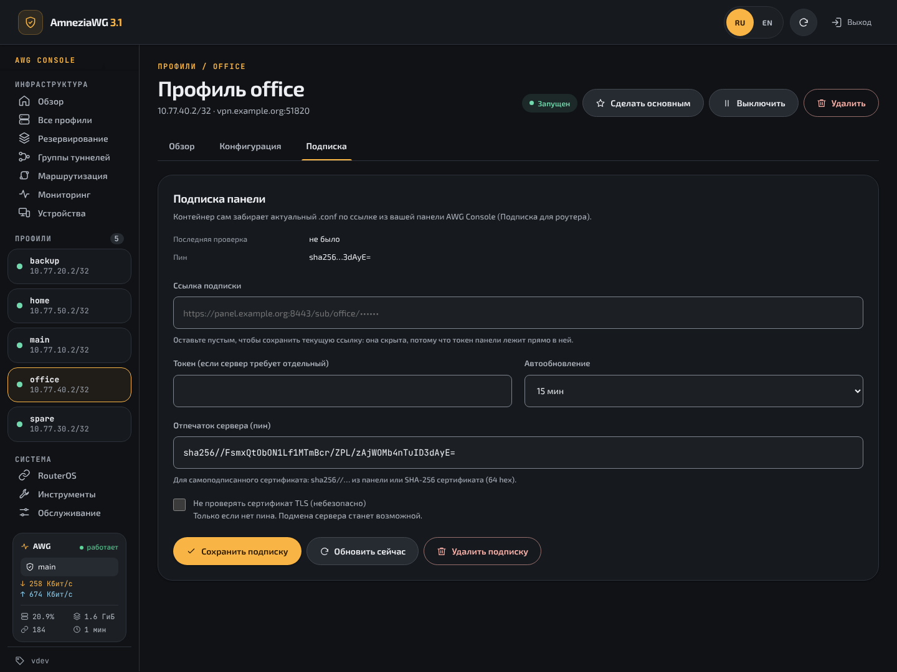
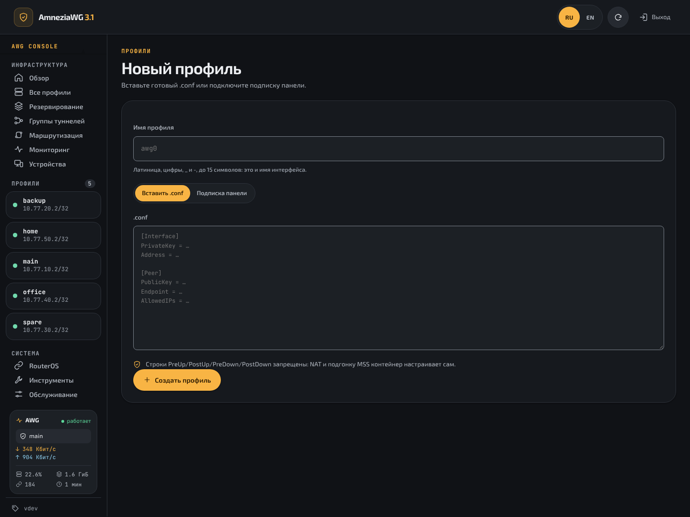
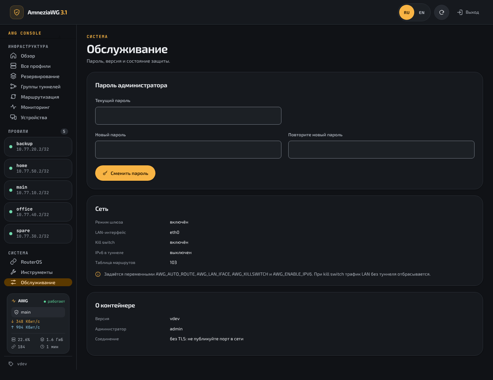
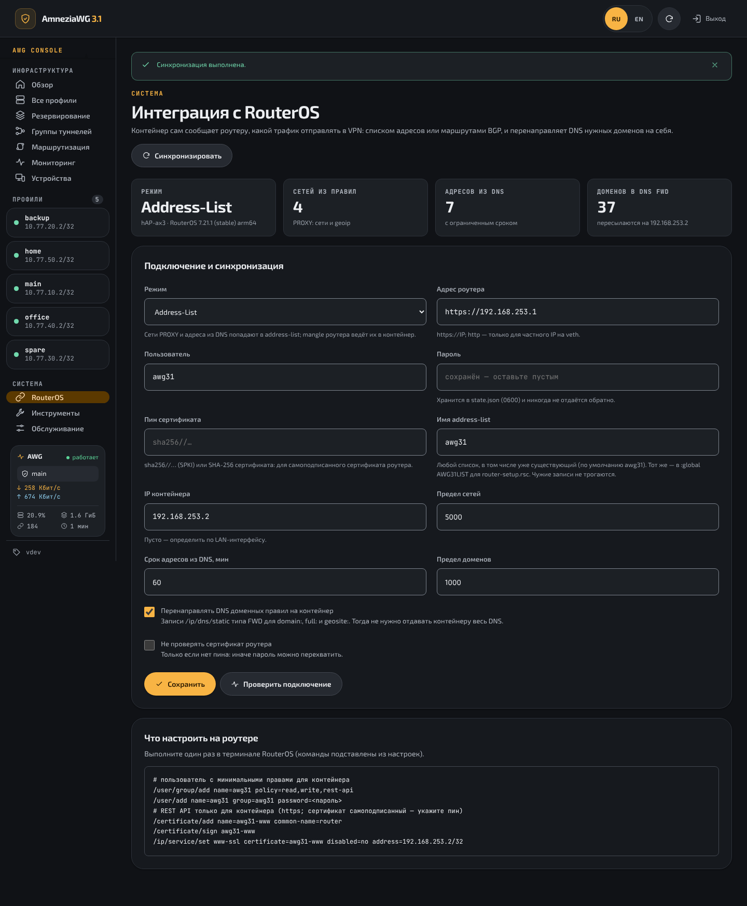
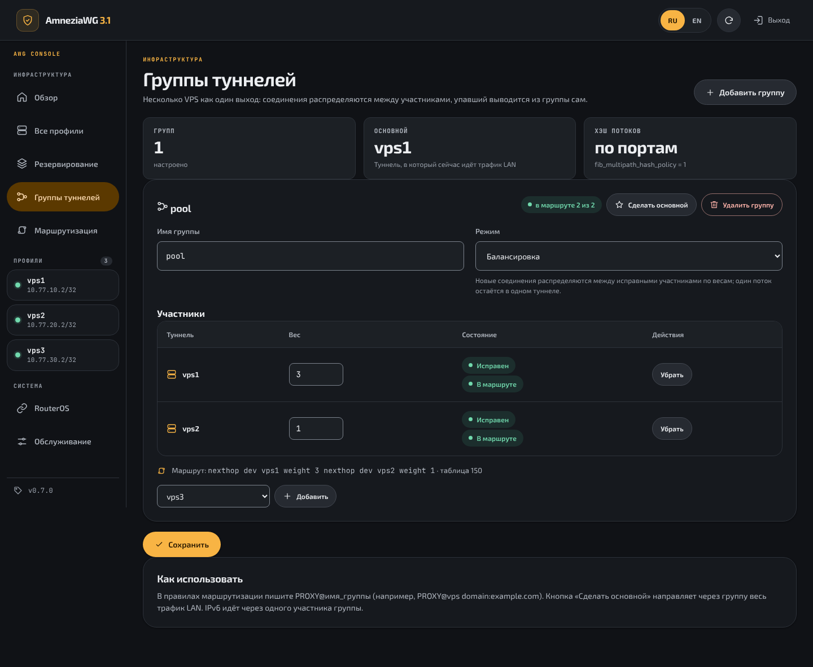

# AmneziaWG 3.1 Console для Docker

[English](README.md) · **Русский**

Клиент **AmneziaWG 3.1** в контейнере с двуязычной (RU/EN) веб-консолью в том же оформлении, что и панель [amneziawg31-installer](https://github.com/stepm65/amneziawg31-installer): профили `.conf`, подъём и остановка туннелей, автозапуск после перезагрузки и **подписка прямо из вашей панели**. Работает в Docker и **на роутерах MikroTik (arm64 и arm32)**. Без CDN, без внешних зависимостей Go, без веб-терминала.

Версия **0.8.2** · лицензия GPL-3.0 · проект не связан с разработчиками AmneziaVPN.



## Возможности

- **Только AmneziaWG 3.1.** Образ собирает `amneziawg-go` и `amneziawg-tools` из upstream; и тег, и хеш коммита зафиксированы, поэтому переставленный тег сборку не подменит.
- **Подписка панели.** Контейнер сам забирает актуальный `.conf` по ссылке `https://адрес/sub/<интерфейс>/<токен>` из раздела «Подписка для роутера» вашей панели: условные запросы по `ETag` (ответ `304`), закрепление ключа сервера `sha256//…` для самоподписанного сертификата, понятные ответы на `403`, `404` и `429`. Подробности ниже.
- **Откат при неудаче.** Если новый конфиг не поднялся, возвращается прежний файл и прежний туннель; метка `ETag` не продвигается, поэтому следующая проверка попробует снова.
- **Обход зависшего туннеля.** Если рукопожатий нет дольше 3 минут и ссылка недоступна, туннель на время опускается и конфиг запрашивается напрямую, как делает скрипт `awg-sub.sh` панели.
- **Строгая проверка `.conf`** по списку ключей upstream 3.1: `Jc`, `Jmin`, `Jmax`, `S1`–`S4`, `H1`–`H4`, `I1`–`I5`, `HeaderProtectionKey`, `ContentPaddingAddition`, `RandomTrailers`, `DisableCookies`, `RekeyAfterTime`, `RekeyTimeout`, `RejectAfterTime`, `KeepaliveTimeout`, `MaxHandshakeAttempts`, `AdvancedSecurity` у пира. Диапазоны `a-b`, ключи base64 по 32 байта, порты и CIDR проверяются по типу.
- **Несколько профилей** одновременно: подъём и остановка, рукопожатие и трафик по каждому пиру, автозапуск поднятых туннелей после перезапуска контейнера.
- **Режим шлюза:** трафик LAN идёт в туннель через отдельную таблицу маршрутов, а собственный трафик контейнера (подписка, рукопожатия) — напрямую; NAT (`MASQUERADE`) и подгонку MSS генерирует само приложение (`AWG_AUTO_ROUTE=on`).
- **Несколько туннелей и резервирование:** туннели работают одновременно, у каждого своя таблица маршрутов; основной (куда идёт трафик LAN) меняется одной командой без перезапуска. Режимы «горячий резерв» (все подняты, переключение мгновенное) и «переключение» (поднят только основной); сбой определяется по рукопожатию, TCP-пробе через конкретный туннель или по обоим; порог неудач, пауза после сбоя, возврат к более приоритетному. Страница «Резервирование» с порядком и состоянием туннелей.
- **Группы туннелей и балансировка:** несколько VPS как один выход. Режим «Балансировка» распределяет новые соединения между исправными участниками по весам (один поток остаётся в одном туннеле), режим «По порядку» направляет трафик через первого исправного. Упавший участник выводится из маршрута сам, вернувшийся (после паузы) добавляется обратно. Группа назначается основным выходом или используется в правилах: `PROXY@группа` («эти сайты — через VPS-1, а если он упал, то через VPS-2»). Страница «Группы туннелей».
- **Маршрутизация по правилам и DNS:** правила `PROXY` / `PROXY@туннель` / `PROXY@группа` / `DIRECT` / `DROP` по доменам, `geosite:`, `geoip:` и сетям; базы v2ray `geosite.dat`/`geoip.dat` (или текстовые списки) скачиваются по расписанию, в память грузятся только нужные категории. DNS-форвардер (UDP/TCP, DoH) отправляет запросы для `PROXY` через туннель, для `DIRECT` — мимо, для `DROP` отвечает NXDOMAIN; адреса из ответов запоминаются, чтобы трафик к ним шёл тем же путём. Страница «Маршрутизация» — таблица сервисов: значок, условия, куда направить, переключатель и перетаскивание строк; каталог сервисов со значками работает без интернета, а сами правила остаются обычным текстом (его можно править руками). Источник баз переключается одной кнопкой, в том числе на [IPList](https://iplist.opencck.org/) (теги там называются по сайтам и группам, например `geoip:telegram.org`; каталог сервисов переключается на них сам). Есть проверка «куда пойдёт этот домен или IP».
- **Интеграция с RouterOS:** контейнер сам ведёт на роутере address-list (сети `PROXY` — постоянно, адреса из DNS — со сроком) или анонсирует их по **BGP**, и добавляет в `/ip/dns/static` записи FWD для доменных правил. Работает через REST API RouterOS 7 под отдельным пользователем с минимальными правами; сертификат роутера закрепляется пином, чужие записи не трогаются. Страница «RouterOS» с проверкой подключения и готовыми командами для роутера.
- **Режим сервера:** профиль с `ListenPort` и пирами без `Endpoint` поднимается как сервер AmneziaWG — клиенты выходят в интернет через LAN контейнера; на MikroTik порт 51821/udp пробрасывается правилами `awg31_server_*`.
- **Kill switch и IPv6:** пока туннеля нет, трафик LAN отбрасывается, а не уходит мимо VPN (`AWG_KILLSWITCH=on`); IPv6 в туннеле с NAT66, а на MikroTik — ULA-адрес на veth, если роутер IPv6 не выдал (`AWG_ENABLE_IPV6=on`).
- **Интерфейс как у панели:** тёмная тема с янтарным акцентом, шрифты Exo 2 и JetBrains Mono из самого образа, боковое меню, карточки, переключатель **RU / EN** (выбор запоминается в браузере), адаптивная вёрстка до телефона.
- **MikroTik RouterOS:** образы `linux/arm64` и `linux/arm/v7`, манифест `/app`, скрипты установки и маршрутизации по address-list, офлайн-архивы `.tar` в каждом релизе. Подробно: [docs/MIKROTIK.md](docs/MIKROTIK.md).
- **Проба здоровья** для `/tool/netwatch` RouterOS или любого мониторинга: только код ответа, без тела.
- **Безопасные умолчания:** одноразовый токен первичной настройки, HTTPS по умолчанию, строгий CSP без inline-кода, CSRF-проверки, секреты не возвращаются через API. Каждая найденная в прототипе проблема связана с тестом: [docs/SECURITY.md](docs/SECURITY.md).

## Требования

| | |
|---|---|
| Docker | Docker Engine с Compose v2 на Linux; `/dev/net/tun` и право `NET_ADMIN` |
| Архитектура | amd64, arm64, arm/v7 (multi-arch образ из CI) |
| MikroTik | RouterOS 7.20+ (7.22+ для `/app`), пакет `container`, arm64 или arm (ARMv7), внешний диск |
| Сеть | исходящий HTTPS к панели; UDP-доступ к вашему AmneziaWG-серверу |

## Быстрый старт

```bash
docker compose up -d --build
docker logs awg31          # здесь токен первичной настройки
```

Откройте <https://127.0.0.1:8443> (сертификат самоподписанный, его SHA-256 отпечаток выводится в журнале), введите токен из журнала, задайте логин и пароль (не короче 10 символов). Затем добавьте профиль и нажмите «Поднять».

По умолчанию консоль доступна только с localhost хоста. Чтобы открыть её из локальной сети, измените `ports` в `docker-compose.yml`. **Не публикуйте порт в интернет.** За обратным прокси задайте `TRUSTED_PROXIES`.

Пароль можно задать и без токена, секретом: `ADMIN_PASSWORD_FILE=/run/secrets/awg31_admin_password` (см. комментарии в `docker-compose.yml`).

## MikroTik

На роутере RouterOS 7.22+ достаточно одной команды:

```
/app/add yaml-url="https://raw.githubusercontent.com/stepm65/awg31-docker/main/routeros/app.yaml"
```

Для RouterOS 7.20–7.21 и для установки без интернета: `routeros/install-container.rsc` (с архивом `.tar` нужной архитектуры из релиза), затем `routeros/router-setup.rsc`. Поддерживаемые модели, маршрутизация по address-list и что проверено: [docs/MIKROTIK.md](docs/MIKROTIK.md).

## Подписка из панели

Так контейнер получает конфигурацию клиента, который вы создали в [AWG Console](https://github.com/stepm65/amneziawg31-installer):

1. В панели откройте клиента → «Подписка для роутера» → **«Включить подписку»**. Панель один раз покажет ссылку вида `https://ваш-адрес/sub/awg0/…` и скрипт `awg-sub.sh`.
2. В консоли контейнера: **Новый профиль → Подписка панели**, вставьте ссылку. Токен лежит прямо в ней, отдельное поле «Токен» не нужно (оно остаётся для серверов, которые ждут `Authorization: Bearer`).
3. Для самоподписанного сертификата панели вставьте отпечаток ключа из `awg-sub.sh` (значение после `--pinnedpubkey`, вид `sha256//…`) либо SHA-256 самого сертификата (64 hex-символа). Если пина нет, проверяется цепочка сертификата; «Не проверять TLS» отдельная и явная опция, не рекомендуется.
4. Выберите интервал (от 5 минут) и сохраните. Кнопка «Обновить сейчас» делает проверку сразу.

Что важно знать:

- **Ссылка — это секрет.** Токен панели лежит в адресе, а по ссылке отдаётся закрытый ключ клиента. Поэтому API контейнера **никогда не возвращает ссылку целиком**: в интерфейсе видно `https://…/sub/awg0/••••••` (последний сегмент пути скрывается всегда, учётные данные из адреса не показываются). Если оставить поле пустым при сохранении, прежняя ссылка сохраняется. В тексте ошибок ссылка тоже скрыта.
- **Ответы панели.** `304` — ничего не менялось; `403` — клиент в панели отключён; `404` — ссылка недействительна (выпущена новая); `429` — слишком частые запросы, подождите. Остальное — сетевая ошибка. Сообщения видны в интерфейсе на странице профиля.
- **Хуки из подписки отбрасываются.** Панель может добавить в `[Interface]` строки `PreUp`/`PostUp`/`PreDown`/`PostDown` и `Table` (шаблоны шлюза для роутеров). `awg-quick` выполняет их через `eval`, поэтому контейнер их **не выполняет**: удаляет из полученного конфига, а `Table` оставляет только со значением `auto` или `off`. Над профилем появляется уведомление о том, что именно убрано. NAT и MSS контейнер настраивает сам. Вручную загруженный `.conf` с хуками по-прежнему отклоняется целиком.
- **Обновление не ломает рабочее.** Конфиг сначала очищается и проверяется, потом записывается; туннель перезапускается, только если он был поднят и содержимое изменилось. Если новый конфиг не поднялся, возвращается прежний (см. «Откат при неудаче»).

## Переменные окружения

| Переменная | Назначение | По умолчанию |
|---|---|---|
| `DATA_DIR` | Каталог данных (профили, `state.json`, TLS) | `/data` |
| `UI_LISTEN` | Адрес консоли внутри контейнера | `:8443` |
| `UI_TLS` | `auto` (самоподписанный сертификат), `files` (свой), `off` | `auto` |
| `UI_TLS_CERT`, `UI_TLS_KEY` | Пути к сертификату и ключу при `UI_TLS=files` | — |
| `UI_TLS_SANS` | Дополнительные имена/IP в самоподписанном сертификате | — |
| `AWG_AUTO_ROUTE` | Режим шлюза: NAT, MSS-clamp и маршрутизация трафика LAN в отдельную таблицу | `on` |
| `AWG_KILLSWITCH` | Kill switch: пока туннеля нет, трафик LAN отбрасывается (blackhole), а не уходит мимо VPN | `on` |
| `AWG_ENABLE_IPV6` | IPv6 в туннеле: NAT66, правила и маршруты IPv6; если IPv6 в контейнере нет, работает только IPv4 | `on` |
| `AWG_LAN_IFACE` | Интерфейс, через который приходит трафик LAN | интерфейс маршрута по умолчанию |
| `DNS_ENABLE` | DNS-форвардер для правил по доменам (в режиме шлюза) | `on` |
| `DNS_LISTEN` | Адрес форвардера | `:53` |
| `DNS_ALLOW` | От кого принимать запросы (CIDR через запятую); по умолчанию частные сети и loopback — форвардер не становится открытым резолвером | частные сети |
| `AWG_FAILOVER_MODE`, `AWG_FAILOVER_TRIGGER`, `AWG_FAILOVER_PROBE`, `AWG_FAILOVER_FAILBACK` | Начальные настройки резервирования (`off`/`standby`/`switch`, `hybrid`/`handshake`/`probe`, `IP:порт`, `on`/`off`); применяются один раз, дальше меняются на странице «Резервирование» | `off`, `hybrid`, `1.1.1.1:443`, `off` |
| `AWG_BIN`, `AWG_QUICK_BIN` | Пути к `awg` и `awg-quick` (для нестандартных сборок и тестов) | `/usr/bin/awg`, `/usr/bin/awg-quick` |
| `ADMIN_USER`, `ADMIN_PASSWORD_FILE` / `ADMIN_PASSWORD` | Задать администратора при первом запуске, без токена (предпочтителен файл-секрет) | — |
| `ALLOW_INSECURE_SUBSCRIPTIONS` | Разрешить `http://` в подписках (**не рекомендуется**: ключ пойдёт открытым текстом) | `off` |
| `TRUSTED_PROXIES` | Прокси (IP/CIDR), чьему `X-Forwarded-For` можно верить | — |
| `HEALTH_LISTEN` | Адрес пробы здоровья, например `:8081` | выключено |
| `HEALTH_MAX_HANDSHAKE_SEC` | Максимальный возраст рукопожатия для пробы (`0` — не проверять) | `0` |
| `RUN_DIR` | Каталог рабочих копий конфигов (в compose — tmpfs) | `/run/awg31` |

## Консоль

| Вход | Обзор |
|---|---|
|  |  |

| Резервирование | Профиль |
|---|---|
|  |  |

| Маршрутизация и DNS | Подписка панели |
|---|---|
|  |  |

| Новый профиль | Обслуживание |
|---|---|
|  |  |

| Интеграция с RouterOS | Группы туннелей |
|---|---|
|  |  |

На скриншотах демонстрационные данные и тестовый стенд без настоящего туннеля. Английские версии лежат рядом (`docs/screenshots/en-*.png`).

## Безопасность

Коротко: токен первичной настройки; HTTPS и cookie `__Host-` по умолчанию; хуки `awg-quick` не исполняются; ссылка подписки и ключи не возвращаются через API; SSRF-защита для подписок; `cap_drop: ALL` + `NET_ADMIN`; никакого веб-терминала. Полная таблица «проблема → решение → тест», остаточные риски и что не проверялось: [docs/SECURITY.md](docs/SECURITY.md). Сообщить об уязвимости: [SECURITY.md](SECURITY.md).

## Пока не реализовано

Это осознанно отложено, чтобы ядро было небольшим и проверяемым. В панели есть, здесь нет:

- Telegram-бот и уведомления, двухфакторный вход, резервные копии, управление парком VPS;
- QR-коды и формат `vpn://`, журналы, графики трафика.

## Разработка

```bash
go vet ./... && go test -race ./...
node --check internal/web/static/app.js
```

Внешних Go-зависимостей нет, только стандартная библиотека. Интерфейс встроен в бинарник (`//go:embed`), вместе со шрифтами. Версия живёт в файле `VERSION`: Dockerfile читает её при сборке, CI сверяет с тегом, а тест не даёт ей разойтись с README. Структура: [docs/ARCHITECTURE.md](docs/ARCHITECTURE.md).

## Лицензии

GPL-3.0, см. [LICENSE](LICENSE). Шрифты и upstream-компоненты образа (`amneziawg-go`, `amneziawg-tools`) распространяются по своим лицензиям: [THIRD_PARTY.md](THIRD_PARTY.md).
